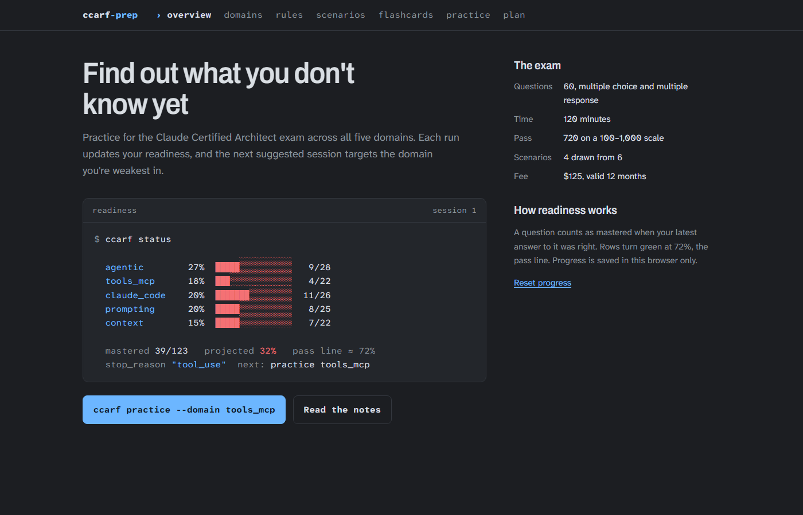
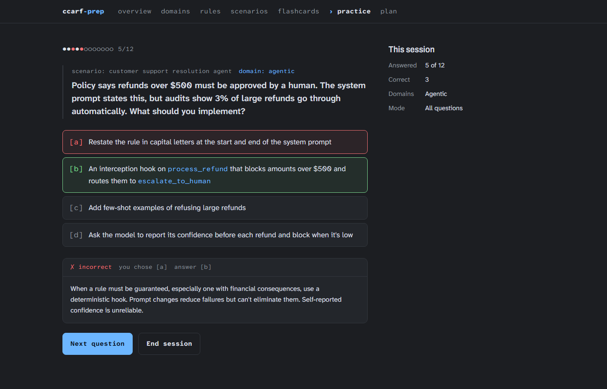
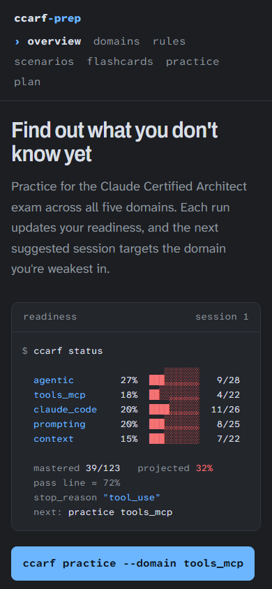
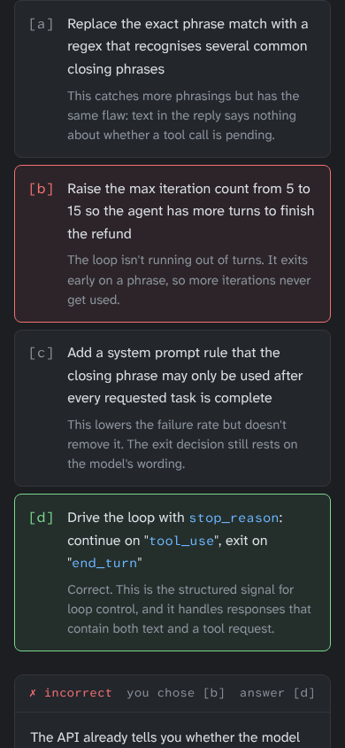
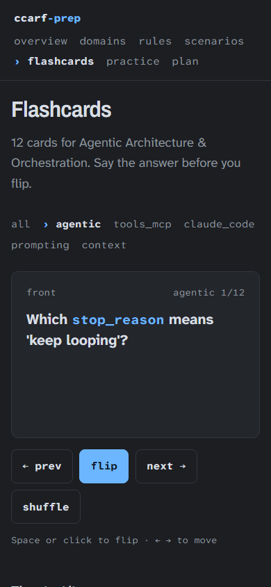
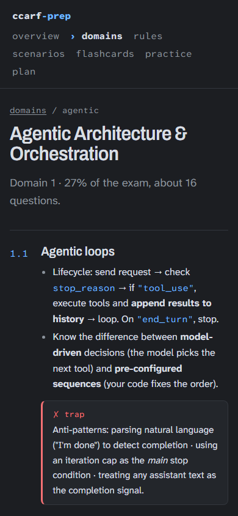

# CCAR-F Prep

A study app for the **Claude Certified Architect – Foundations** (CCAR-F) exam. It covers all five exam domains with notes, decision rules, the six exam scenarios, 94 flashcards and 123 practice questions, most of them framed in an exam scenario. It tracks how ready you are per domain, and it always suggests practising the domain you're weakest in.

It's a server-rendered Django app with no build step. It also exports a **static build for GitHub Pages** that you can install on your phone's home screen and use offline.

> **About the questions:** every practice question in this repo is original, written to exercise the skills in the public exam guide. None of them are real exam items, and none come from the exam.

| Overview | Practice feedback |
|---|---|
|  |  |

<p>
  
  
  
  
</p>

Screenshots of every page at 1400px and 390px are in [`docs/`](docs/). The approved design mock-up is [`docs/design-preview.png`](docs/design-preview.png).

## Features

- **Overview (`/`):** shows the output of `$ ccarf status`.
  - One row per domain, with its exam weight, a █/░ bar and a mastered count. Rows are green from 72%, amber from 50%, red below that.
  - A projected score: Σ(weight × mastered/total).
  - A `stop_reason` line. It reads `"tool_use"` with `next: practice <weakest domain>` and switches to `"end_turn"` (book the exam) once every domain is at 85% or more.
  - The primary button, `ccarf practice --domain <slug>`, starts a run for the weakest domain.
- **Guide (`/guide/`):** a one-page exam briefing. It covers exam logistics with domain weights, how questions are written, ten principles, essentials per domain, key values and where things live, wrong-answer patterns, and a night-before checklist.
- **Domains:** every task statement for each domain, with "trap" and "what wins" callouts.
- **Decision rules:** 36 "if this symptom → pick that fix" rows.
- **Scenarios:** the six exam scenarios, the domains each one covers, what to look for, and a `ccarf practice --scenario <n>` button to drill one.
- **Flashcards:** each card's back has the answer plus a *Trap* / *Why* / *Exam tell* line that ties it to how questions are asked. One card at a time, with flip, prev/next, shuffle and arrow keys. The deck remembers your card (and shuffle order) per filter, so it reopens where you left off. Without JavaScript the page shows a readable list of every card.
- **Practice:**
  - Filter by domain and/or scenario, and pick a mode. The default skips questions whose latest answer was right, so mastered questions drop out of practice; the other modes are all questions, only the ones you missed, or only unanswered. The overview's quick-start button uses the default too, and falls back to all questions once a domain is fully mastered.
  - Questions framed in a scenario say so, e.g. `scenario: customer support resolution agent  domain: agentic`.
  - Questions and choices are shuffled once per run.
  - Multi-select questions ("Select TWO") are graded on exact match.
  - Questions are written like exam items: a scenario stem with real constraints, four options that each sound plausible, and a qualifier such as *best*, *first* or *most reliable*.
  - After each answer you get feedback in the style of the design: `✗ incorrect  you chose [a]  answer [b]`, a line under **every** option saying why it is right or worse, and the key idea behind the question.
  - A ●●◉○○ progress line, results by domain, and a "retry missed" button.
- **Study plan:** a 10-day plan plus the four hands-on exercises from the exam guide.
- **Reset:** a confirm page, then a POST that clears this browser's progress.

## Use it on your phone (GitHub Pages)

`manage.py build_site` renders every page with the same templates into plain HTML. In that build, a small `app.js` runs the practice flow in the browser and keeps progress in the phone's local storage. A service worker caches the whole site, so it also works offline.

**One-time setup:**
1. Push to GitHub.
2. Open the repository's **Settings → Pages** and set **Source: GitHub Actions**.
3. The `Deploy to GitHub Pages` workflow (`.github/workflows/pages.yml`) runs the tests, builds the site and publishes it on every push to `main`. Your site is at `https://<user>.github.io/<repo>/`.

**Install on your phone:**
- **iPhone (Safari):** tap Share, then **Add to Home Screen**.
- **Android (Chrome):** tap the ⋮ menu, then **Install app** (or **Add to Home screen**).

It opens full-screen like an app.

Some things to know:
- **Progress is per device.** Your phone and laptop each keep their own, just as the server version keeps it per browser.
- **Clearing site data for the page erases your progress.** The app asks the browser to keep its storage persistent. An installed home-screen app on iOS keeps its own storage, separate from Safari.

To preview the static build locally:

```sh
uv run python manage.py build_site --out _site
uv run python -m http.server 8001 -d _site   # http://127.0.0.1:8001
```

## Quick start

You need Python 3.12+ and [uv](https://docs.astral.sh/uv/).

```sh
uv sync
cp .env.example .env              # DEBUG=true for local development
uv run python manage.py migrate   # creates the schema and loads all study content
uv run python manage.py runserver
```

Open http://127.0.0.1:8000. If you edit `study/content/ccarf.json`, refresh the database with:

```sh
uv run python manage.py load_content   # safe to re-run; keeps everyone's progress
```

### Docker

```sh
docker build -t ccarf-prep .
docker run -p 8000:8000 -v ccarf-data:/data \
  -e SECRET_KEY=change-me -e ALLOWED_HOSTS=localhost -e SECURE_SSL_REDIRECT=false \
  ccarf-prep
```

The image runs `collectstatic` at build time. On start it runs `migrate`, then gunicorn. SQLite lives in the `/data` volume.

### Configuration

| Variable | Default | Notes |
|---|---|---|
| `SECRET_KEY` | (none) | Required unless `DEBUG` is on |
| `DEBUG` | `false` | |
| `ALLOWED_HOSTS` | `localhost,127.0.0.1` when debugging | Comma-separated |
| `CSRF_TRUSTED_ORIGINS` | (empty) | Comma-separated, with scheme, e.g. `https://prep.example.com` |
| `DATABASE_PATH` | `./db.sqlite3` | |
| `SECURE_SSL_REDIRECT` | `true` when not debugging | Set to `false` if TLS ends somewhere else and the proxy doesn't send `X-Forwarded-Proto` |
| `SECURE_HSTS_SECONDS` | `0` | Opt in once the site is HTTPS-only |

## Tests and linting

```sh
uv run pytest                               # unit and integration tests (fast, no browser)
uv run playwright install chromium          # once
uv run pytest -m e2e                        # browser smoke tests against a live server
uv run ruff check . && uv run ruff format --check .
```

What the suites cover:

- **Content integrity** (`tests/test_content.py`)
  - 5 domains whose weights sum to 100, plus the expected counts of everything else.
  - Every question has a correct choice.
  - Every "Select N" prompt matches its number of correct answers.
- **Loader** (`test_loader.py`)
  - It's idempotent and keeps Attempts.
  - Edits update rows in place, and removed items are pruned.
- **Pages** (`test_pages.py`)
  - Every page returns 200, and unknown slugs return 404.
  - Nav state, and the admin with Choice as an inline on Question.
- **Practice flow** (`test_practice.py`)
  - Domain filter, shuffle persistence, single and multi-select grading.
  - Tampered answers are rejected, and a question can't be answered twice.
  - Missed and unanswered modes, results by domain, retry, per-session isolation, reset.
- **Readiness math** (`test_progress.py`)
  - The latest attempt decides mastery.
  - Status thresholds, the weighted projection, weakest-domain choice with its tie-break, and the 85% `end_turn` switch.
- **`codeify` filter** (`test_codeify.py`): wraps identifiers and escapes HTML before wrapping.
- **Static build** (`test_static_site.py`): every page is written, every link respects the base path, no POST forms remain, `content.json` is complete and codeified, and the service worker only precaches files that exist.
- **e2e** (`tests/e2e/`)
  - The server app: start a run, answer, see feedback, reach results; plus the flashcard flip.
  - The static build, served from a sub-path like GitHub Pages: a full practice run that updates the overview's readiness, reset, and offline loading through the service worker.

CI (`.github/workflows/ci.yml`) has three jobs:

- **lint:** ruff.
- **test:** pytest, `check --deploy` and a missing-migrations check.
- **e2e:** installs Chromium and runs the browser tests.

To regenerate the screenshots, run the dev server, then `uv run python scripts/screenshots.py`.

## Architecture

```
config/              settings (env-driven), urls, wsgi
study/
  models.py          Domain, TaskStatement, DecisionRule, Scenario, Flashcard,
                     Question, Choice, Attempt
  content_loader.py  JSON → database, keyed on natural keys
  progress.py        mastery, readiness, projected score, weakest domain, stop_reason
  practice.py        PracticeRun (session state), question pools, grading
  views.py           thin views over the two modules above
  templatetags/      codeify, bar
  content/ccarf.json all study content
  static_site.py     the GitHub Pages export (build_site command)
  static/study/      trace.css, woff2 fonts, flashcards.js, app.js (static build),
                     manifest + icons
tests/               pytest-django suites, plus e2e/ for Playwright
```

### Decisions

**Browser sessions instead of accounts.**
- Progress is tied to Django's session key: each graded answer is an `Attempt(session_key, question, selected, is_correct)`.
- There's no sign-up, which suits a personal study tool. The session cookie lasts a year so progress survives between study days.
- The trade-off is that progress doesn't follow you to another device. If that matters later, adding a nullable `user` foreign key to `Attempt` is a small change.

**Mastery is your latest attempt.**
- A question counts as mastered when your most recent answer to it was correct. It's one `Subquery` per page.
- This lets readiness go down as well as up, which a "correct at least once" rule can't.

**Content loads in a data migration.**
- `migrate` alone gives a working app, both in tests (pytest-django runs migrations) and in the Docker entrypoint.
- The same `content_loader.load()` backs `manage.py load_content`. It upserts on natural keys (domain number, task code, rule/question order, card position) and prunes rows that disappeared from the JSON. Attempts survive reloads unless their question was deleted.
- It takes a `get_model` callable so the migration can pass historical models. The catch: the migration imports live loader code, so the loader has to stay compatible with older schemas. For example, it only sets `Question.scenario` when the model has that field.
- When the schema changes, add a data migration that reruns the loader (as `0004_reload_content` does). Existing databases, including the Docker volume, then pick up the content on their next `migrate`.

**Grading happens on the server.**
- The browser only ever sends choice ids. The server checks they belong to the current question, then grades by exact set match: every correct choice and nothing else.
- The shuffled question order and per-question choice order are stored in the session when the run starts. Reloads and back-button use never reshuffle, and the `[a]`/`[b]` letters in the feedback always match what you saw.
- Answers are POST → redirect → GET, so refreshing never grades twice.

**One codebase, two deployments.**
- The Django app is the reference implementation.
- The GitHub Pages build reuses its templates through the test client with `STATIC_SITE=True`. Templates then swap their few POST forms for buttons, and `app.js` (about 400 lines) mirrors `progress.py` and `practice.py` in the browser.
- Prompt, choice and explanation HTML is codeified at build time, so the browser never has to escape anything.
- The trade-off: in the static build, grading happens in the browser and the answers ship in `content.json`. That's fine for self-study, and it's why the server version keeps grading on the server.
- The e2e suite runs the same practice flow against both versions.

**Templates first, minimal JavaScript.**
- Every page works without JS. Flashcards enhance a plain list into a single flip card.
- Choices are real `<label>`/`<input>` pairs (radio, or checkbox for multi-select). Keyboard focus is visible, and `prefers-reduced-motion` turns off the flip animation.

**codeify escapes, then wraps.**
- Prompts, choices and explanations are plain text. The filter HTML-escapes them first, then wraps `snake_case` and `SCREAMING_SNAKE` identifiers in `<code>`. The only markup it can emit is its own.
- The trusted HTML fields from the content file (`body_html`, `back_html`) are rendered as-is.

**Design.**
- The CSS comes from the approved "Trace" mock-ups. Archivo is used for headings, Atkinson Hyperlegible Next for body text and Atkinson Hyperlegible Mono for the terminal-style UI.
- The fonts are converted to woff2 and self-hosted, served by WhiteNoise with hashed, compressed filenames.
- Under 640px the readiness panel switches to a 10-cell bar and wraps its footer, so it fits a phone without scrolling sideways.

## Content and licences

- **Study content:** `study/content/ccarf.json` holds the domains, task-statement notes, decision rules, scenarios, flashcards and practice questions. Each practice question is grounded in a task statement from the notes, so its explanation matches what the app teaches. Questions can carry a `scenario` number (1–6). `tests/test_content.py` checks the tags, the "Select N" counts, and that the longest choice isn't usually the answer. The exam facts (60 questions, 120 minutes, 720/1000 to pass, 4 of 6 scenarios, $125) come from the public exam guide; check them against the current guide before you book.
- **Fonts:** Archivo and Atkinson Hyperlegible are licensed under the SIL Open Font License 1.1.
